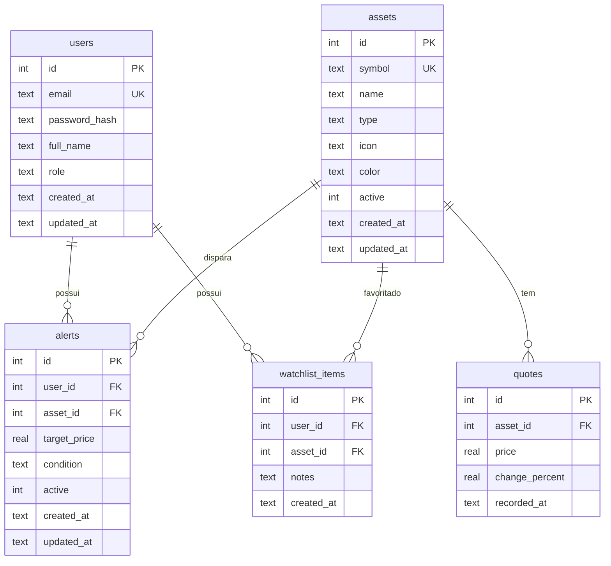

# Diagrama de dados — MoedaX

Banco: SQLite (`backend/db/moedax.db`)

## Entidades (5)

| Entidade | Descrição |
|---|---|
| `users` | Usuários da API (HTTP Basic) com perfil `investidor` ou `administrador` |
| `assets` | Ativos de mercado (crypto/fiat) |
| `quotes` | Cotações históricas vinculadas a um ativo |
| `alerts` | Alertas de preço por usuário e ativo |
| `watchlist_items` | Favoritos (lista de acompanhamento) |

## Relacionamentos

- `users` 1:N `alerts`
- `users` 1:N `watchlist_items`
- `assets` 1:N `quotes`
- `assets` 1:N `alerts`
- `assets` 1:N `watchlist_items`
- `watchlist_items` UNIQUE (`user_id`, `asset_id`)

## Diagrama ER



## Arquitetura em camadas

```text
HTTP Request
    → routes/            (roteamento)
    → middleware/        (auth + erros)
    → controllers/       (entrada/saída HTTP)
    → services/          (regras de negócio)
    → repositories/      (acesso a dados SQLite)
    → db/moedax.db
```
